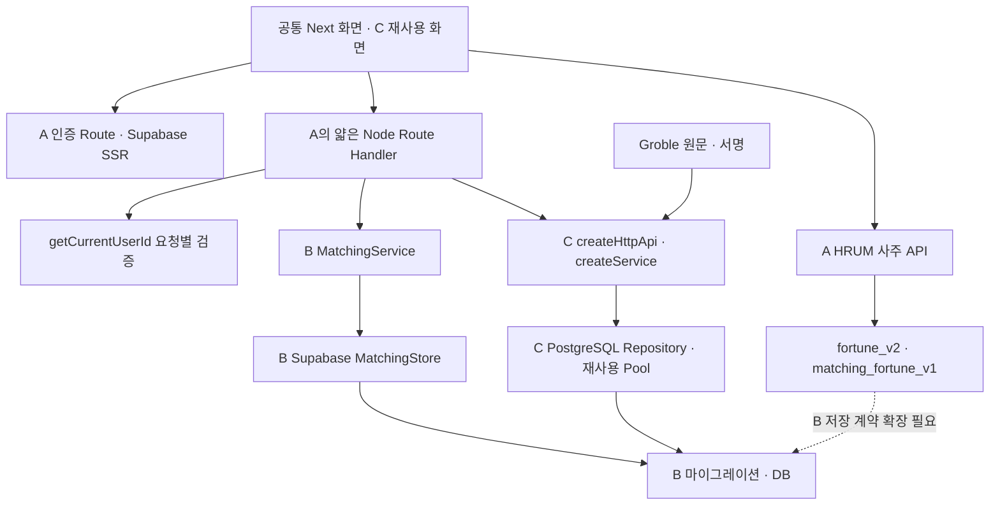

# A 공통 앱과 B·C 통합 설계

확인일: 2026-11-18, Asia/Seoul. 사용자 요청에 따라 **실제 팀 저장소를 읽고 수정한 A 설계**다. 이 문서의 목표 구조와 아직 합치지 않은 코드는 현재 실행 가능한 통합 결과와 구분한다.

## 기준과 현재 상태

- 팀 저장소: [sanghoo0628/saju](https://github.com/sanghoo0628/saju).
- 전달받은 최소 기준: `codex/c-payment-chat@c0984046248ce4f4200eb933e55446f4ff6e7881`.
- 실제 조사 시 브랜치 끝: `b4cdf40c6c2d30235222a2a41187855e634f32bd`, 위 기준보다 6커밋 앞. 마지막 구현은 `60ed07c`, 끝 커밋은 인수인계 문서다. 결제 복귀·Realtime 준비·요청함·UI 변경을 보존한다. 합치기 직전에 다시 fetch하고 그 뒤의 팀원 변경도 검토한다.
- `c098404` 기본 검사는 상위 기록상 Vitest 104 + C Node 61 = 165개. 조사한 끝 커밋의 기록은 기본 233 + UI 18 = 251개다. **이번 A 작업에서 이 상위 검사들을 재실행한 것은 아니다.** 네이티브 PostgreSQL 10개는 별도이며 상위 환경에서는 shared memory 제한으로 미실행이었다.
- 현재 로컬은 A 앱과 HRUM 코드다. 이번에는 C 공유 타입을 원문 그대로 가져오고 A 타입/설정/검사 경계를 준비했다. B·C 서비스, DB 마이그레이션, pg 의존성 전체를 가져오거나 실제 DB에 연결하지 않았다. remote 설정·브랜치 생성·커밋·main 반영은 실행하지 않았다.

## 역할과 의존 방향



A는 인증·사주와 서버 조립부를 소유한다. B의 추천/프로필/SQL과 C의 주문/트랜잭션/대화 로직을 다시 구현하지 않는다. C 트랜잭션을 여러 Supabase REST 호출로 치환하지 않는다. 활동·예약 P1/P2는 이번 통합 범위 밖이다.

## 파일 배치와 보존

| 경로 | 처리 |
|---|---|
| `src/app/`, `src/components/`, `src/lib/auth/`, `src/lib/supabase/` | A 공통 앱 유지. 실제 C 기능은 화면과 Route 조립부로 연결 |
| `src/features/fortune/` | A HRUM 어댑터·공통 3주 데이터 유지 |
| `contracts/payment-chat.ts` | C 원본을 단일 출처로 사용. 이번 로컬에 동일 내용으로 추가 |
| `src/contracts/collaboration.ts` | 기존 A 제안 제거, C 타입 재수출과 호환 이름만 제공 |
| `src/contracts/matching.ts`, `src/lib/score.ts`, `src/lib/matching.ts` | B 원래 경로 보존. A의 옛 추천 DTO를 B의 API라고 사용하지 않음 |
| `src/server/matching-service.ts`, `supabase-store.ts` | B 서비스 재사용 |
| `src/server/postgres-repository.ts`, `postgres-transaction.ts` | C의 실제 pg 구현 보존 |
| `src/server/payment-chat-runtime.ts` | 통합 시 A가 추가할 server-only 조립부. C factory와 검증된 gateway를 연결 |
| `packages/payment-chat/` | C service/http/client 및 최신 복귀·Realtime·요청함 모듈 보존 |
| `packages/payment-chat-ui/` | 독립 데모 유지. Next에는 재사용 컴포넌트와 live props만 연결 |
| `supabase/migrations/20261116000100_…` ~ `20261116000600_…` | 기존 6개 SQL의 내용·순서 보존. HRUM 저장은 B의 추가 migration으로 확장 |
| `tests/` | B/Vitest 원래 검사 보존. 통합 시 A의 Node 검사는 `tests/a/`로 이동하고 import/fixture 경로 조정 |

`packages/payment-chat-ui/src/App.tsx`, `catalog.ts`, `demo-client.ts`, `demo/`는 운영 조립에 포함하지 않는다. 최신 UI의 `currentUserId`, B 공개 프로필 props, 명시적으로 켠 demo 옵션 경계를 유지한다. Realtime 연결/해제는 C 모듈을 재사용하며 실제 권한 검증 완료로 간주하지 않는다.

## 인증·풀·서버 조립 계약

`src/lib/auth/get-current-user-id.ts`의 `getCurrentUserId(): Promise<string | null>`은 유지한다. 요청 쿠키의 Supabase `auth.getUser()`가 검증한 UUID만 반환한다. 사용자 ID를 전역 캐시에 저장하지 않는다. 설정 오류는 미인증 null과 구분한다.

실제 C factory는 다음과 같다.

```ts
createPaymentChatDatabase(connectionString, { pool?, repository? })
// { pool, repository, close }
createService({ repository, gateway, id?, now? })
createHttpApi({ service, getCurrentUserId, appOrigin, onUnexpectedError? })
// (request: Request) => Promise<Response>
```

통합할 `payment-chat-runtime.ts`는 `import 'server-only'`를 최상단에 두고, **최초 실제 요청에서** 설정을 검사한 뒤 pool/service/handler를 생성한다. 프로세스별로 재사용하고 개발 HMR에서도 중복 생성하지 않도록 전역 캐시에 사용자 정보 없는 runtime만 둔다. build/모듈 import 단계에서 DB 접속이나 migration을 실행하지 않는다. 재시작 시 설정을 적용하며 요청마다 `database.close()`하지 않는다.

- Supabase SSR client는 계속 요청별 생성. 세션 없는 관리자 client·pool과 다른 수명이다.
- C HTTP 콜백에는 `getCurrentUserId: () => getCurrentUserId()`처럼 함수를 전달한다. 초기화 시 `await getCurrentUserId()`한 값을 보관하지 않는다.
- C의 raw Request를 그대로 handler에 전달한다. A의 `readJson()`으로 먼저 소비하거나 body를 재직렬화하지 않는다.
- C 관련 Route는 `export const runtime = 'nodejs'`. DB 모듈을 Client Component나 브라우저 barrel로 내보내지 않는다.
- C가 `SET LOCAL ROLE service_role`을 사용하므로 DB 로그인 역할에 필요한 권한이 있어야 한다. Supabase Auth 쿠키가 pg 연결에 사용자 RLS 신원을 자동 주입하지 않는다. C의 actor·소유권·참여자·차단 검사를 보존한다.
- 동일 PoolClient의 BEGIN/COMMIT/ROLLBACK, 제한 재시도·연결 반환/폐기를 C 구현 그대로 사용한다. 외부 결제·환불·메일 호출을 재시도되는 DB 콜백 안으로 이동하지 않는다.
- 실제 Groble gateway가 없으면 C 기능의 준비 안 됨/503을 반환한다. 테스트 JSON 검증기나 데모 gateway를 운영 조립부에 주입하지 않는다.
- 현재 A의 결제 flag는 전체 환경 검증에서 true를 거부한다. C 런타임 통합 때 이 검증을 결제 진입점으로 이동한다. 인증·사주가 결제 설정 때문에 함께 503이 되지 않게 한다. 조립부가 없는 현재는 기존 차단을 유지한다.

## HTTP·DTO를 C 구현에 맞추기

| 동작 | 실제 C 계약 | 이전 A 제안에서 바꿀 내용 |
|---|---|---|
| 주문 생성 | `POST /api/orders`, `{matchResultId}` | recipientId/recommendationId를 보내지 않음. 서버가 추천 소유권과 실제 상대를 확인 |
| 생성 결과 | kind=payment_required 또는 chat_available | checkout_required/already_entitled라는 별도 상태를 덧씌우지 않음 |
| 주문 조회 | `GET /api/orders/:id`, `{orderId,status,targetId}` | targetId는 string 또는 null. 빈 문자열·다른 UUID로 대체하지 않음 |
| 요청 생성 | `POST /api/chat-requests`, `{orderId}` | recipientId만으로 요청하지 않음 |
| 요청 조회 | `GET /api/chat-requests?afterId=…` | 요청의 id/from/to 필드 사용 |
| 수락·거절 | `POST /api/chat-requests/:id/accept` 또는 reject | 수신자 무료, 기존 방 재사용 |
| 방 조회 | `GET /api/conversations?afterId=…` | C 응답과 커서 사용 |
| 메시지 조회·전송 | `GET/POST /api/conversations/:id/messages`, 전송은 `{body}` | 작성자·conversation ID를 body 신원으로 신뢰하지 않음 |
| 웹훅 | `POST /api/webhooks/groble` | 사용자 로그인·Origin 검사 제외, raw bytes와 headers로 gateway 검증 |

C 오류 응답은 최상위 `{code,message}`다. A의 `{error:{…}}`로 감싸지 않는다. C browser client가 읽는 형식을 보존한다. 인증 설정 예외를 변환할 때도 C의 `ServiceError('PROVIDER_UNAVAILABLE', 안전한 메시지)` 또는 동일한 503 JSON 형식으로 처리한다. raw 에러·키는 로그/응답에서 제외한다.

`targetId=null`은 삭제된 상대의 주문 기록이다. 본인 주문 이력은 보여줄 수 있지만 프로필 링크·새 대화 요청·새 결제 대상으로 사용하지 않는다. 신규 주문/요청/참여자 ID까지 nullable로 확대하지 않는다. 결제 증빙을 기록하고 refund_pending으로 전환하는 C 동작은 실제 환불 API 실행이 아니다.

아래 두 항목은 기존 요구와 실제 C 구현의 차이이며, **A가 타입만 만들어 충족했다고 보고하지 않는다.**

1. C의 OrderStatus는 단일 pending/fulfilled/cancelled/refund_pending/refunded다. 기존 payment_status·fulfillment_status 분리 요구와 차이가 있다. 현재 UI는 C 상태 그대로 읽고, 두 상태 저장·복구 모델의 확장은 B/C 작업으로 남긴다.
2. 현재 메시지 POST에는 clientMessageId 멱등 키가 없다. 수신 메시지 ID 병합은 재전송 멱등성과 다르다. 응답 유실 시 자동 POST 재시도를 하지 않고 조회/사용자 안내를 유지한다. 서버 멱등 키는 C 추가 구현이 필요하다.

## B 매칭·HRUM 연결에서 해결할 차이

실제 B 진입점은 `createSupabaseMatchingStore(admin)` → `createMatchingService(store)`다. myProfile/updateProfile/matchResults에 서버 검증 userId를 전달한다. 관리자 client 사용이 사용자 권한 검사를 대신하지 않는다. 공개 ProfileCard와 만료되는 사진 서명 URL만 화면에 전달한다.

| 확인 사항 | 통합 처리 |
|---|---|
| B 추천 API는 `/api/match-results`와 `results[].id` | 이 id를 C matchResultId로 그대로 연결. A의 옛 batchId/recommendations/academicTrack 형태를 강제하지 않음 |
| B ready는 1~3명 허용 | 무료 3명 상품 설명과 부족 후보 처리를 별도 정책으로 조정. 3명 미만을 타입 단언·가짜 후보로 채우지 않음 |
| B 점수는 HMAC 숫자와 문이과 부호, abs(a+b) 정렬 | `legacy_demo_v1`로 명시. HRUM 강약 원점수와 관계 없음 |
| B fortune_results의 base_number/score/score_version은 NOT NULL | HRUM 분석만으로 이 테이블에 저장할 수 없음. 0·랜덤값·LLM 점수로 필수 컬럼을 채우지 않음 |
| B 프로필·추천이 fortuneScore 존재를 요구 | 실제 분석 준비 상태와 legacy 점수 유무를 분리하는 B 서비스·저장 계약 확장 필요 |
| A 입력은 음력 원본 일자·timezone·계산 옵션·동의를 보존 | 음력 일자를 PostgreSQL date에 양력처럼 넣지 않음. 원본 달력일자와 변환 기준/동의 버전 저장은 B 추가 migration으로 확장 |
| HRUM `fortune_v2`와 `matching_fortune_v1` | 본인 상세와 공통 3주를 분리. fingerprint·비교키·adapter/engine 버전·null 의미를 유지 |

따라서 HRUM 성공을 B legacy 등록 성공으로 자동 번역하지 않는다. providerSex를 프로필 gender나 문이과 track으로 복사하지 않는다. hybrid 선택 시 승인 규칙/저장 계약이 없으면 추천 진입점은 명시적 not_ready여야 하며 B의 legacy RPC로 우회하지 않는다. 이 확장 전에도 인증·사주 화면과 C 공통 연결 준비는 진행한다.

## 환경 변수 통일

| 이름 | 용도·전환 |
|---|---|
| `NEXT_PUBLIC_APP_URL` | 공통 Origin. 기존 B/C NEXT_PUBLIC_SITE_URL을 이 값으로 조립부에 주입 |
| `NEXT_PUBLIC_SUPABASE_URL` | 같은 팀 개발 프로젝트의 HTTP URL |
| `NEXT_PUBLIC_SUPABASE_PUBLISHABLE_KEY` | A 브라우저/SSR 공개 키. 기존 ANON_KEY와 혼용하지 않고 설정 이전 |
| `SUPABASE_SECRET_KEY` | A 관리자 client에 주입할 서버 키. B store는 env를 직접 읽지 않으므로 client를 주입. 기존 SERVICE_ROLE_KEY 값/형식의 사용 가능 여부는 팀 환경에서 확인 |
| `DATABASE_URL` | C pg 전용, DB 접속 문자열/TLS/역할 확인. NEXT_PUBLIC_ 금지 |
| `ALLOWED_EMAIL_DOMAINS` | 팀이 확인한 목록만 설정. 특정 학교를 임의 기본 허용하지 않음 |
| `SAJU_PROVIDER`, `SAJU_API_KEY`, `SAJU_FINGERPRINT_SECRET` | HRUM/mock 선택과 서버 키. SAJU_USE_MOCK/SAJU_API_URL 대신 명시적 provider 계약 |
| `SCORE_HMAC_SECRET` | B의 legacy 점수용. SAJU_FINGERPRINT_SECRET과 분리. 현재 A는 이를 소비하지 않음 |
| `GROBLE_PAYMENT_URL`, `GROBLE_PRODUCT_ID`, `GROBLE_WEBHOOK_SECRET` | 실제 gateway 계약·상품 연결 시 사용. ref가 포함된 결제 URL과 주문 복귀 URL 구분 |
| `APP_ENV`, 결제 enable flags | 환경·기능 준비 상태. flag만으로 미연결 gateway를 성공 상태로 만들지 않음 |

실제 값은 `.env.local` 또는 배포 비밀 저장소로 설정하며 채팅·Git·문서에 남기지 않는다. 사주 공급자 실패를 mock 성공으로 대체하지 않는다.

## Node·pnpm·TypeScript와 테스트 설계

Node 24.x, pnpm 11.25.0을 유지한다. 기존 C root package.json을 기준으로 A 의존성을 합친다. **pg 8.23.1은 dependencies에 유지**하고 @types/pg 8.23.1, PGlite 0.5.16, pglite-socket 0.2.19, embedded-postgres 18.6.0-beta.19, Vitest 등 C 테스트 의존성을 누락하지 않는다. 최신 버전으로 임의 갱신하지 않는다.

- workspace는 루트와 `packages/*`. 공통 React/React DOM 및 타입은 A의 고정 버전으로 정리하되 C UI 렌더 검사·빌드로 호환성을 확인한다.
- npm lock을 보존한 통합 checkout에서 `pnpm import`로 변환하고 의존성 diff를 확인한다. 기존 UI lock의 해상도도 비교한다. import는 완전한 1:1 변환이 아니며 기존 pnpm lock을 교체하므로 현재 A 파일에 무작정 실행하지 않는다.
- 루트 `pnpm-lock.yaml`로 모든 workspace 설치를 검증한 뒤 중첩 lock/workspace 및 npm lock을 정리한다. `pnpm install --frozen-lockfile`가 재현되어야 전환 완료다.
- C의 strict/noUncheckedIndexedAccess/allowImportingTsExtensions를 보존한다. A에 이 두 추가 옵션을 실제 반영했다. Next용 root tsconfig와 core/UI 검사 설정의 include를 명시적으로 분리해 데모 서버를 앱 번들에 섞지 않는다.
- A의 TS6/Node24 타입과 C의 TS7/Node26 타입은 현재 다르다. Node24 API 범위와 Next lint 호환을 유지하며 C를 공통 compiler로 재검사한다. TS7 전용 요구가 확인되면 core 전용 검사 workspace를 유지하며 엄격 옵션을 낮추지 않는다. 아직 전체 C 소스를 같은 compiler로 빌드한 결과는 없다.

통합 후 사용할 스크립트 구성(아직 C가 없는 로컬에서 실행 가능한 명령으로 표시하지 않음):

```json
{
  "test": "pnpm run test:all",
  "test:a": "node --conditions=react-server --import tsx --test tests/a/*.test.ts",
  "test:b": "vitest run --config vitest.config.ts",
  "test:payments": "node --test packages/payment-chat/test/*.test.ts",
  "test:all": "pnpm run test:a && pnpm run test:b && pnpm run test:payments",
  "test:ui": "vitest run --config packages/payment-chat-ui/vitest.config.ts",
  "test:postgres": "vitest run --config vitest.postgres.config.ts",
  "demo:dev": "pnpm --filter @saju/payment-chat-ui dev",
  "demo:build": "pnpm --filter @saju/payment-chat-ui build"
}
```

B Vitest include에서 `tests/a/**`와 네이티브 PostgreSQL 파일을 제외한다. C node:test와 UI 렌더 테스트를 같은 runner로 수집하지 않는다. `--conditions=react-server`는 A 검사에만 적용한다. 현재 로컬 `pnpm test`는 A의 test:a(88개)만 실행한다.

기본 검사/별도 UI/별도 네이티브 DB 결과를 따로 기록한다. 숫자가 늘어났다는 이유로 165개나 251개 보존을 선언하지 않고 테스트 목록·runner별 결과를 비교한다. `test:postgres`는 운영 DATABASE_URL을 사용하는 검사가 아니며 임시 로컬 DB의 플랫폼 지원·동시성 검증 결과를 따로 확인한다.

## 통합 순서와 완료 기준

1. 최신 팀 브랜치를 별도 checkout/worktree에 받아 기준 SHA를 기록하고 A 변경을 선별 적용한다. 현재 미커밋 A 폴더를 reset/overwrite하지 않는다. C 브랜치나 main을 강제로 되돌리지 않는다.
2. 위 계약·환경 이름·pnpm/tsconfig/test 수집 범위를 합친다. 기존 B/C 마이그레이션·테스트를 먼저 보존한다.
3. server-only 조립부와 얇은 Route, 실제 인증 callback을 연결한다. 기존 C HTTP parser·오류·웹훅 계약은 그대로 둔다.
4. B 공개 프로필·추천 DTO와 C 최신 live UI props/복귀/요청함/Realtime 수명주기를 연결한다. HRUM 저장·hybrid 준비 안 됨 상태는 명시적으로 유지한다.
5. lint, A 테스트, B/C 기본 검사, 별도 UI 검사, 모든 strict typecheck, Next build, Vite demo build를 수행한다. test:postgres 결과는 별도로 기록한다.
6. 팀이 지정한 개발 DB·실제 로그인 계정으로 소유자/수신자/제3자·차단·삭제대상·재접속을 검증한다. Groble의 서명 규격·테스트 환경이 준비된 뒤에만 실제 gateway를 연결한다.
7. 검증된 작업 브랜치/SHA, 환경 변수 이름, 실행법, 미검증 항목을 전달한다. 이번 요청의 산출물은 재설계와 A 준비 변경이다. main 반영 완료나 전체 통합 165/251개 재검증 완료라고 보고하지 않는다.

## 근거

- [C 공유 계약](https://github.com/sanghoo0628/saju/blob/c0984046248ce4f4200eb933e55446f4ff6e7881/contracts/payment-chat.ts), [C HTTP](https://github.com/sanghoo0628/saju/blob/c0984046248ce4f4200eb933e55446f4ff6e7881/packages/payment-chat/src/http.ts), [pg 어댑터](https://github.com/sanghoo0628/saju/blob/c0984046248ce4f4200eb933e55446f4ff6e7881/src/server/postgres-repository.ts).
- [B 프로필·매칭 계약](https://github.com/sanghoo0628/saju/blob/c0984046248ce4f4200eb933e55446f4ff6e7881/docs/CONTRACT_profile_matching.md), [B 서비스](https://github.com/sanghoo0628/saju/blob/c0984046248ce4f4200eb933e55446f4ff6e7881/src/server/matching-service.ts), [최신 C 인수인계](https://github.com/sanghoo0628/saju/blob/b4cdf40c6c2d30235222a2a41187855e634f32bd/docs/C_RESUME_2026-11-18.txt).
- [node-postgres 트랜잭션](https://node-postgres.com/features/transactions), [pool 재사용](https://node-postgres.com/features/pooling), [Supabase SSR](https://supabase.com/docs/guides/auth/server-side/creating-a-client), [DB 연결](https://supabase.com/docs/guides/database/connecting-to-postgres), [pnpm import](https://pnpm.io/cli/import).
